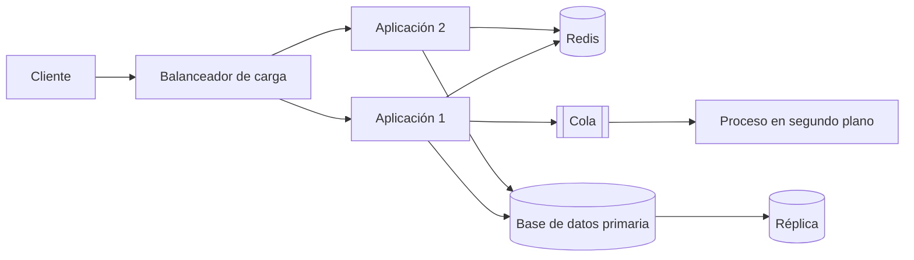

# System Design — Bloque 0 desde First Principles

> **First principles** (primeros principios) significa no memorizar recetas ("poné una caché, poné Kafka"), sino partir de las pocas verdades que no se pueden discutir y **derivar** el diseño desde ahí. Si entendés los axiomas, las "mejores prácticas" se vuelven obvias.

## Índice

1. [Los 6 axiomas](#los-6-axiomas)
2. [0.1 Framework de 4 pasos](#01-framework-de-4-pasos)
3. [0.2 Requisitos funcionales versus no funcionales](#02-requisitos-funcionales-versus-no-funcionales)
4. [0.3 Estimación de capacidad](#03-estimación-de-capacidad)
5. [0.4 Acuerdos, objetivos e indicadores de nivel de servicio, y los nueves](#04-acuerdos-objetivos-e-indicadores-de-nivel-de-servicio-y-los-nueves)
6. [0.5 Trade-offs](#05-trade-offs)
7. [0.6 Ciclo de vida del software, diseño de alto y bajo nivel, y diagramas](#06-ciclo-de-vida-del-software-diseño-de-alto-y-bajo-nivel-y-diagramas)
8. [Ejemplo integrador](#ejemplo-integrador-acortador-de-urls)
9. [Hoja de referencia rápida](#hoja-de-referencia-rápida)

---

## Los 6 axiomas

Todo el diseño de sistemas sale de estas seis verdades.

| # | Axioma | Consecuencia directa |
|---|---|---|
| 1 | **Los recursos son finitos**: una máquina tiene procesador, memoria, disco y red limitados | Cuando la carga supera a una máquina, hay que **repartir** el trabajo (escalar) |
| 2 | **Mover datos cuesta tiempo**, y la luz tiene velocidad finita | Acercá los datos a quien los usa (caché, red de distribución de contenido, réplicas) y evitá viajes de red |
| 3 | **Todo falla** (discos, redes, personas, despliegues) | Hace falta **redundancia** y diseñar para recuperarse |
| 4 | **Coordinar cuesta**: para que dos máquinas se pongan de acuerdo hay que comunicarlas | Más consistencia significa más latencia y menos disponibilidad (es un trade-off) |
| 5 | **Alguien tiene una necesidad real** (el usuario, el negocio) | El diseño existe para cumplir requisitos, no para ser elegante |
| 6 | **El tiempo, el dinero y la atención son limitados** | Empezá simple, estimá antes de construir y decidí con criterio |

**Regla de oro derivada:** un componente solo existe si resuelve un problema concreto que viene de uno de estos axiomas. Si no podés decir de cuál, sacalo.

---

## 0.1 Framework de 4 pasos

### Derivación

- Axioma 5: sin entender la necesidad, diseñás lo equivocado. **Primero entender.**
- Axioma 6: no podés resolver todo a la vez. **Primero lo grueso, después el detalle.**
- Axioma 3: un diseño que no considera las fallas está incompleto. **Cerrar revisando riesgos.**

De ahí salen los 4 pasos:

| Paso | Pregunta que responde | Qué hacés | Tiempo (en una entrevista de 45 minutos) |
|---|---|---|---|
| 1. Entender | ¿Qué problema, para quién y a qué escala? | Preguntar, acotar el alcance y fijar los requisitos | 5 a 8 minutos |
| 2. Diseño de alto nivel | ¿Qué piezas mínimas lo resuelven? | Estimar, definir la interfaz de programación (API), los datos y el diagrama de bloques | 10 a 15 minutos |
| 3. Análisis en profundidad (deep dive) | ¿Dónde está el riesgo o la dificultad real? | Profundizar 2 o 3 componentes críticos | 15 a 20 minutos |
| 4. Cierre | ¿Qué se rompe y cómo evoluciona? | Revisar puntos únicos de falla, cuellos de botella, monitoreo y qué pasa con diez veces más carga | 3 a 5 minutos |

**Principio:** arrancá con el diseño más simple que cumpla (un servidor, una base de datos) y agregá cada componente **solo cuando un número o un requisito lo justifique**.

**Preguntas del paso 1:** ¿cuántos usuarios hay? ¿La carga es de lectura o de escritura? ¿Se necesita tiempo real o tolera demora? ¿Qué pasa si se cae? ¿Qué queda fuera del alcance?

---

## 0.2 Requisitos funcionales versus no funcionales

### Derivación

Un sistema responde dos preguntas independientes: **qué hace** y **qué tan bien lo hace**.

- **Requisitos funcionales**: *qué hace*. "El usuario puede acortar una URL." Se reconocen porque son verbos del usuario.
- **Requisitos no funcionales**: *cómo se comporta*. "Responde en menos de 100 milisegundos, el 99,95% del tiempo." Son adjetivos del sistema.

**Por qué los requisitos no funcionales mandan en la arquitectura:** dos sistemas con los mismos requisitos funcionales pueden ser totalmente distintos. Un chat para 1.000 usuarios cabe en un servidor; el mismo chat para 500 millones necesita particionado de datos, colas y réplicas. Lo que cambió fueron los requisitos no funcionales, no las funciones.

| Requisito no funcional | Se deriva de | Pregunta |
|---|---|---|
| Latencia | Axioma 2 (mover datos cuesta) | ¿Cuál es el tiempo de respuesta objetivo para el percentil 99? |
| Rendimiento (throughput) y escalabilidad | Axioma 1 (recursos finitos) | ¿Cuántas consultas por segundo hay en el pico? ¿Y con diez veces más usuarios? |
| Disponibilidad y confiabilidad | Axioma 3 (todo falla) | ¿Cuánto tiempo caído se tolera? |
| Consistencia | Axioma 4 (coordinar cuesta) | ¿Eventual o fuerte? |
| Durabilidad | Axioma 3 | ¿Se puede perder algún dato? |
| Costo, seguridad y observabilidad | Axiomas 6 y 5 | ¿Cuál es el presupuesto? ¿Hay datos sensibles? |

**El dato que más pesa:** la proporción entre **lecturas y escrituras**.

- Lectura intensiva (por ejemplo, un acortador de URLs, con 100 lecturas por cada escritura): caché, réplicas de lectura y red de distribución de contenido.
- Escritura intensiva (por ejemplo, registros de eventos o dispositivos conectados): colas, procesamiento por lotes y particionado.

**Consejo:** decir en voz alta qué queda **fuera del alcance** también demuestra criterio.

---

## 0.3 Estimación de capacidad

### Derivación

Axioma 1 (recursos finitos) más axioma 6 (tiempo limitado): necesitás saber **de qué tamaño es el problema** antes de elegir la solución, y alcanza con el **orden de magnitud**. La estimación responde: ¿entra en una máquina o hay que repartir?

### Los números base (hay que memorizarlos)

**Tiempo**

```
1 día     ≈ 86.400 segundos ≈ 10^5 segundos
1 mes     ≈ 2,5 millones de segundos (2,5 x 10^6)
1 año     ≈ 30 millones de segundos (3 x 10^7)
1 millón de requests por día ≈ 12 consultas por segundo
```

**Potencias de 2**

| 2^10 | 2^20 | 2^30 | 2^40 | 2^50 |
|---|---|---|---|---|
| 1 kilobyte | 1 megabyte | 1 gigabyte | 1 terabyte | 1 petabyte |

Cada 10 de exponente multiplica el valor por unos 1.000.

**Tamaños típicos:** un entero ocupa 4 bytes, una marca de tiempo 8 bytes, un identificador único universal 16 bytes, un tweet unos 300 bytes, un registro de usuario cerca de 1 kilobyte, una foto unos 2 megabytes y un minuto de video unos 100 megabytes.

**Latencias** (de acá salen casi todas las decisiones de diseño)

| Operación | Latencia |
|---|---|
| Memoria RAM | unos 100 nanosegundos |
| Disco de estado sólido, lectura aleatoria | unos 150 microsegundos |
| Viaje de ida y vuelta dentro del mismo datacenter | unos 0,5 milisegundos |
| Leer 1 megabyte de forma secuencial desde un disco de estado sólido | unos 1 milisegundo |
| Búsqueda en un disco rígido mecánico | unos 10 milisegundos |
| Viaje de ida y vuelta entre continentes | unos 150 milisegundos |

**Qué te dice la tabla:** la memoria RAM es unas 1.000 veces más rápida que un disco de estado sólido, y por eso existe la caché. Un viaje entre continentes cuesta lo mismo que miles de accesos a la memoria RAM, y por eso existen las redes de distribución de contenido y las réplicas regionales.

### Las 5 fórmulas

```
Consultas por segundo (promedio) = requests por día / 86.400
Consultas por segundo (pico)     = promedio x 2 a 5
Almacenamiento                   = objetos por día x tamaño x días de retención x 3 (replicación)
Ancho de banda                   = consultas por segundo x tamaño de cada respuesta
                                   (calcularlo por separado para lo que entra y lo que sale)
Memoria de caché                 ≈ 20% de las lecturas diarias x tamaño   (regla 80/20)
```

**Cantidad de servidores** = consultas por segundo en el pico / consultas por segundo que soporta un servidor. Referencias gruesas (aclaralas como supuesto): un servidor de aplicación maneja unas 1.000 consultas por segundo, un nodo de Redis entre 50.000 y 100.000 operaciones por segundo, y un PostgreSQL de un solo nodo entre miles y decenas de miles de consultas por segundo según la complejidad.

### Ejemplo rápido

10 millones de usuarios activos por día, con 20 lecturas cada uno: 200 millones de lecturas por día. Dividido por 10^5 segundos da **2.000 consultas por segundo** en promedio. Multiplicado por 3 para el pico, son unas **6.000 consultas por segundo**.

### Reglas

1. Escribí los supuestos antes de calcular.
2. Redondeá sin miedo (usá 10^5 en vez de 86.400).
3. Escribí siempre las unidades (no mezcles bits con bytes).
4. No te olvides del pico, la replicación ni la retención.
5. Verificá que el resultado tenga sentido.

---

## 0.4 Acuerdos, objetivos e indicadores de nivel de servicio, y los nueves

### Derivación

Axioma 3 (todo falla): no existe el 100%. Entonces hay que **definir cuánta falla se tolera**, **medirla** y **prometerla**. De ahí salen tres conceptos:

| | Qué es | Pregunta | Ejemplo |
|---|---|---|---|
| **Indicador de nivel de servicio (SLI)** | La **métrica** | ¿Qué mido? | Porcentaje de requests exitosos en menos de 300 milisegundos |
| **Objetivo de nivel de servicio (SLO)** | La **meta interna** | ¿Qué objetivo me pongo? | 99,95% en 30 días |
| **Acuerdo de nivel de servicio (SLA)** | El **contrato** con consecuencias | ¿Qué prometo, y pago si fallo? | 99,9% mensual; si no se cumple, hay un crédito en la factura |

**El objetivo interno debe ser más exigente que el acuerdo con el cliente**, para tener margen antes de incumplir el contrato.

**Percentiles, no promedios:** si 99 requests tardan 100 milisegundos y 1 tarda 10 segundos, el promedio (unos 200 milisegundos) parece bien, pero 1 de cada 100 usuarios sufre. Por eso se miden el **percentil 95 y el percentil 99**.

### Los nueves

| Disponibilidad | Tiempo caído por año | Tiempo caído por mes |
|---|---|---|
| 99% | 3,65 días | 7,2 horas |
| 99,9% | 8,76 horas | 43 minutos |
| 99,99% | 52,6 minutos | 4,3 minutos |
| 99,999% | 5,26 minutos | 26 segundos |

**Cada nueve divide el tiempo caído por 10, pero multiplica el costo por mucho más.**

### Cuentas que salen de los axiomas

- **Disponibilidad** = tiempo medio entre fallas / (tiempo medio entre fallas + tiempo medio de recuperación). Se mejora fallando menos o recuperándose más rápido (lo segundo suele ser más barato).
- **Componentes en serie** (todos deben funcionar): las disponibilidades se multiplican. 99,9% x 99,9% ≈ 99,8%. *Cada dependencia en serie te baja la disponibilidad.*
- **Componentes en paralelo** (alcanza con que funcione uno): la probabilidad de falla se multiplica. Dos réplicas de 99% dan 99,99%. *Por eso la redundancia funciona.*
- **Presupuesto de errores** = 100% menos el objetivo. Con un objetivo de 99,9% tenés unos 43 minutos por mes de falla "permitida"; si se agota, se frena el desarrollo y se prioriza la estabilidad.
- **Tiempo objetivo de recuperación**: cuánto tardás en volver a funcionar tras una falla. **Punto objetivo de recuperación**: cuántos datos (medidos en tiempo) aceptás perder.

---

## 0.5 Trade-offs

### Derivación

Los axiomas se contradicen entre sí: **no se puede tener todo**. Lo que se evalúa es que sepas qué ganás y qué pagás.

**El más importante (axiomas 3 y 4): el teorema CAP y el modelo PACELC**

Las redes fallan (axioma 3), así que ante una partición de la red hay que elegir:

- **Consistencia (CP)**: se rechazan operaciones para no dar datos inconsistentes (dinero, inventario).
- **Disponibilidad (AP)**: se sigue respondiendo con datos posiblemente viejos y se reconcilia después (feeds, likes, carritos de compra).

Sin falla, igual hay un trade-off (modelo PACELC): **consistencia fuerte contra latencia**, porque coordinar réplicas lleva tiempo.

**Consistencia, de más fuerte a más débil:** fuerte, causal, leer lo que uno mismo escribió, eventual.

### Trade-offs clásicos

| Eje | De dónde sale |
|---|---|
| Consistencia contra disponibilidad y latencia | Coordinar cuesta |
| Latencia contra rendimiento (procesamiento por lotes) | Recursos finitos |
| Lectura contra escritura (índices, caché) | Más estructuras hacen más caras las escrituras |
| Espacio contra tiempo (precalcular o calcular al vuelo) | Memoria finita contra cómputo finito |
| Normalizar contra desnormalizar | Menos redundancia o menos uniones entre tablas |
| Sincrónico contra asincrónico | Respuesta inmediata o desacople y tolerancia a picos |
| Sin estado (stateless) contra con estado (stateful) | Sin estado escala más fácil |
| Escalar en vertical contra en horizontal | Simple pero con techo, o escala más pero es más compleja |
| Simplicidad contra escalabilidad | Atención limitada |
| Costo contra rendimiento | Dinero limitado |

### Fórmula para justificar una decisión

> "Elijo **X** en lugar de **Y** porque el requisito **R** pide **Z**. El costo es **C** y lo acepto porque **motivo**. Si cambia **la condición**, reconsideraría **Y**."

**Ejemplo:** "Elijo consistencia eventual para los likes porque lo que prima es la latencia baja; el costo es que dos usuarios vean números distintos por un instante. Para un saldo bancario haría lo contrario."

**Evitá:** elegir una tecnología "porque la usa Netflix", la sobre-ingeniería (Kafka para 100 usuarios), decir "siempre" o "nunca", y no mencionar las desventajas de tu propia decisión.

**Consejo:** salvo que haya una razón concreta, empezá con **PostgreSQL**; escala bastante más de lo que se cree.

---

## 0.6 Ciclo de vida del software, diseño de alto y bajo nivel, y diagramas

### Ciclo de vida del desarrollo de software

Son las etapas por las que pasa un sistema; el diseño ocurre sobre todo en la segunda.

1. Requisitos y análisis. 2. **Diseño**. 3. Implementación. 4. Pruebas. 5. Despliegue (con integración y despliegue continuos). 6. Operación y mantenimiento. 7. Retiro.

En entornos ágiles el diseño no se congela: se hace uno inicial suficiente y se refina en cada iteración (axioma 6).

### Diseño de alto nivel contra diseño de bajo nivel

Es la misma idea a dos niveles de zoom:

| | **Diseño de alto nivel (HLD)** | **Diseño de bajo nivel (LLD)** |
|---|---|---|
| Responde | ¿Qué componentes hay y cómo se comunican? | ¿Cómo está construido cada uno por dentro? |
| Contiene | Servicios, bases de datos, caché, colas, balanceador de carga, flujo de datos | Clases, tablas e índices, algoritmos, patrones de diseño |
| Audiencia | Arquitectos, líderes técnicos, producto | Quien lo va a programar |
| Ejemplo | "Diseñá Twitter" | "Diseñá las clases de un estacionamiento" |

En un acortador de URLs: el **alto nivel** es cliente, balanceador de carga, aplicación, Redis y base de datos. El **bajo nivel** es el método `UrlService.shorten()`, la codificación en Base62 y la tabla `urls(id, code UNIQUE, long_url, expires_at)`.

### Diagramas de alto nivel

| Diagrama | Para qué sirve |
|---|---|
| **De bloques o de arquitectura** | Vista general (el principal) |
| **De secuencia** | Orden de los mensajes en un caso de uso |
| **Entidad-relación** | Entidades de datos y sus relaciones |
| **De despliegue** | Regiones, zonas y clusters, y alta disponibilidad |

Flujo típico de un request: `Cliente → DNS y red de distribución de contenido → Balanceador de carga → Aplicación sin estado → Caché → Base de datos (más réplicas) → Cola → Procesos en segundo plano → Almacenamiento de objetos`.



**Buenas prácticas:** un nivel de abstracción por diagrama; flechas rotuladas (HTTP, gRPC, SQL); línea sólida para lo sincrónico y punteada para lo asincrónico; marcá los puntos únicos de falla y los cuellos de botella; anotá las consultas por segundo y los tamaños; empezá simple y agregá componentes a medida que los justificás.

**Registro de decisiones de arquitectura:** una nota corta por cada decisión importante, con el contexto, la decisión, las alternativas y las consecuencias.

---

## Ejemplo integrador: acortador de URLs

**1. Entender.** Requisitos funcionales: acortar, redirigir, alias personalizado, expiración. Requisitos no funcionales: alta disponibilidad, percentil 99 de latencia menor a 100 milisegundos, durabilidad. Supuestos: 100 millones de URLs nuevas por mes, 100 lecturas por cada escritura, retención de 5 años.

**2. Estimar.**

```
Escrituras:     100 millones / 2,5 millones de segundos ≈ 40 consultas por segundo
Lecturas:       x100 ≈ 4.000 consultas por segundo (pico x3 ≈ 12.000)
Almacenamiento: 100 millones x 12 meses x 5 años = 6.000 millones de registros
                x 500 bytes = 3 terabytes (≈ 9 terabytes con replicación x3)
Ancho de banda: 4.000 x 500 bytes = 2 megabytes por segundo (despreciable)
Caché:          345 millones de lecturas por día x 500 bytes x 20% ≈ 35 gigabytes
Código corto:   Base62 elevado a 7 ≈ 3,5 billones de combinaciones: alcanza de sobra
```

**Lectura de los números:** el tráfico es bajo y los datos caben en pocas máquinas, así que no hace falta nada exótico. Sí hace falta **caché** (por la proporción 100 a 1 de lecturas) y **réplicas** (por la disponibilidad).

**3. Diseñar.** `POST /urls` y `GET /{code}` con redirección. Cliente, balanceador de carga, aplicaciones sin estado, Redis (cache-aside), PostgreSQL (primaria más réplicas).

**4. Análisis en profundidad.** Generación de códigos: un contador distribuido codificado en Base62, sin colisiones. Redirección 301 contra 302: la 301 reduce la carga pero perdés el conteo de clics; la 302 permite contarlos (es un trade-off).

**5. Cerrar.** Objetivo de nivel de servicio: 99,95% y percentil 99 de latencia menor a 100 milisegundos. Puntos únicos de falla: el balanceador de carga (se duplica) y la base de datos primaria (cambio automático a una réplica). Monitorear: consultas por segundo, tasa de aciertos de la caché, percentil 99 de latencia, errores 5xx y retraso de replicación.

---

## Hoja de referencia rápida

```
1 día = 86.400 segundos ≈ 10^5 | 1 mes ≈ 2,5 x 10^6 | 1 millón de requests por día ≈ 12 consultas por segundo
2^10 = kilobyte | 2^20 = megabyte | 2^30 = gigabyte | 2^40 = terabyte | 2^50 = petabyte
Memoria RAM 100 nanosegundos | Disco de estado sólido 150 microsegundos | Mismo datacenter 0,5 milisegundos
Disco rígido 10 milisegundos | Entre continentes 150 milisegundos
99,9% = 8,76 horas caído por año | 99,99% = 52,6 minutos | 99,999% = 5,26 minutos

Consultas por segundo = requests por día / 86.400      Pico = promedio x 2 a 5
Almacenamiento = objetos por día x tamaño x días x 3
Ancho de banda = consultas por segundo x tamaño         Caché ≈ 20% de las lecturas diarias x tamaño
En serie: A1 x A2        En paralelo: 1 - (1 - A1) x (1 - A2)
Disponibilidad = tiempo medio entre fallas / (tiempo medio entre fallas + tiempo medio de recuperación)
```

**Lista de verificación antes de cerrar:**

- [ ] Requisitos funcionales y no funcionales claros, y qué queda fuera del alcance
- [ ] Estimaciones con supuestos explícitos
- [ ] Interfaz de programación, datos y diseño de alto nivel
- [ ] Análisis en profundidad de 2 componentes
- [ ] Puntos únicos de falla, fallas y monitoreo
- [ ] Trade-offs con su costo
- [ ] Evolución con diez veces más carga

**Pregunta de oro para cada componente que agregues:** *"¿Qué axioma o requisito me obliga a tenerlo?"* Si no hay respuesta, no va.

**Ejercicios para practicar:** Twitter, WhatsApp, Instagram, YouTube, Dropbox, Uber y un limitador de velocidad de requests. Para cada uno: requisitos, estimación, diseño de alto nivel, 3 trade-offs y un objetivo de nivel de servicio.
